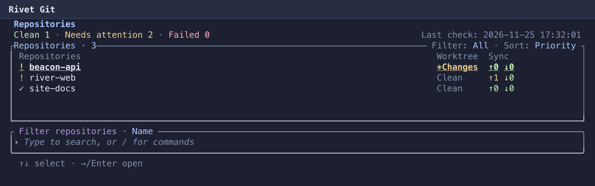
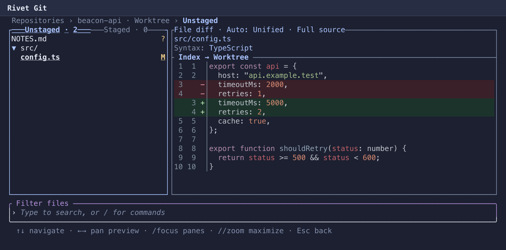
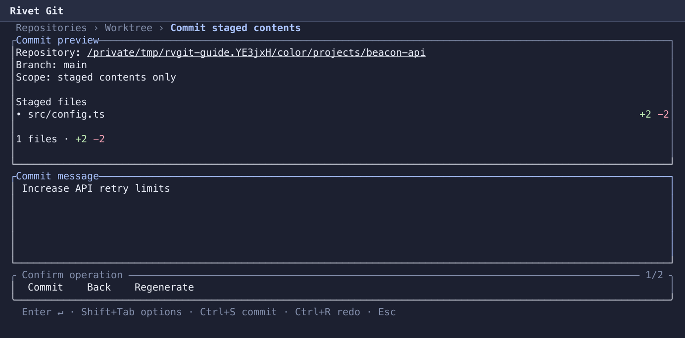
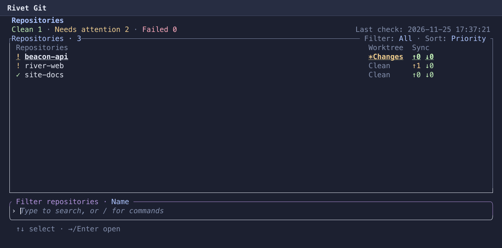

# Rivet Git

English · [简体中文](README.zh-CN.md)

Rivet Git (`rvgit`) gives you a dashboard for multiple Git repositories. See which projects have local changes or commits to sync, then open a repository to review your work, stage changes, and commit from the same terminal.



## Install and launch

With Git and Node.js 20 or newer installed, run:

```sh
npm install -g @efct/rvgit
rvgit repos
```

Prebuilt archives are available on [GitHub Releases](https://github.com/ririv/rvgit/releases/latest) for macOS (Apple silicon and Intel), Linux x64, and Windows x64. Install Git, extract the archive, and run `./rvgit repos` from the extracted folder on macOS or Linux. In Windows PowerShell, run `.\rvgit.exe repos`.

Run `rvgit repos` to open the dashboard from any directory. Run `rvgit` inside a Git repository to open that repository directly.

## Your first commit

Use a repository with changes you want to review. To practice on a disposable repository, run `python3 examples/playground/create.py` from a source checkout. Then run `rvgit --home work/playground/workspace/home repos` from the checkout to open the sample dashboard. See the [playground guide](examples/playground/README.md) for more practice scenarios.

### Add a repository

1. Open the dashboard with `rvgit repos` and follow the setup prompts on your first launch.
2. In the app, type `//repos add "/path/to/project"` and press `Enter`. Replace the example with the path to your Git repository and check the path in the confirmation. Select **Add** and press `Enter`.
3. To register multiple projects, use `//repos scan "/path/to/projects"`. Review the repositories found, toggle selections with `Space`, then choose **Add selected** from the action bar. Use `Shift+Tab` to switch between the list and the action bar.

On the dashboard, type a project name to search or use `↑` and `↓` to select a repository. `Enter` opens it. An entry marked **Changes** has local work to review. The sync columns show commits ahead (`↑`) and behind (`↓`) the upstream branch based on your local remote-tracking refs. Run `//repos fetch` to refresh those refs across the tracked repositories.

### Find a command

Press `/` to see commands for the current view. Type part of a command or search its English or Chinese description. Use `↑` and `↓` to select a result, `Tab` to complete it, and `Enter` to open or run it. `Esc` closes the command list or goes back.

Start with `//` to search all command groups or enter a full command from any view. The examples below use `//` so you can enter them from either the dashboard or a repository view.

### Review and stage a file

1. With a repository selected, run `//repo diff` to open the worktree.
2. In **Unstaged**, use the arrow keys to select a file. The preview shows changes from the index to the worktree. Use `//repo diff layout` to choose a unified or side-by-side view.
3. With the file selected in the list, run `//repo diff stage`. Run `//repo diff staged` to see what will go into the commit, or `//repo diff unstage` on a staged file to take it out of the index.



The staged preview compares `HEAD` with the index. If you edit a file again after staging it, the new edits show in **Unstaged**.

For part of a file, press `Enter` on the file to focus its preview, then run `//repo diff select hunk` or `//repo diff select line`. Use the arrow keys to select the change and press `Space` to stage it. In the staged preview, `Space` unstages the selected change.

### Review and create the commit

1. Run `//repo commit`. Check the repository, branch, and file list in the preview. The commit contains the staged changes.
2. Type a commit message and press `Ctrl+S`. You can also use `Shift+Tab` to reach the action bar, select **Commit**, and press `Enter`.
3. Run `//repo log` to see the new commit. When you are ready to share it, run `//repo push` and review the target and any confirmation the app presents.



### Watch the workflow



## Everyday commands

Enter these commands in the app.

| Command | What it does |
| --- | --- |
| `//repos` | Return to the repository dashboard. |
| `//repos filter` | Choose which repositories to show. |
| `//repos sort` | Choose the dashboard sort order. |
| `//repos fetch` | Fetch all tracked repositories in one batch. |
| `//repo fetch` | Refresh remote-tracking refs for the current repository. |
| `//repo pull` | Bring upstream changes into the current branch. |
| `//repo log` | Browse the current repository's commit history. |
| `//tasks` | Check the status of background operations and see failures. |
| `F1` | Open the built-in help for commands and keys. |

The interface follows your system language. Set `APP_LANG=en` or `APP_LANG=zh` before launch to choose English or Simplified Chinese. In Windows PowerShell, for example, run `$env:APP_LANG = "zh"` before starting Rivet Git.

## Build from source

Install Git and the Rust toolchain with Rustup. Clone the repository:

```sh
git clone https://github.com/ririv/rvgit.git
cd rvgit
```

On macOS, install the Xcode Command Line Tools. On Linux, install a C compiler, `pkg-config`, and the OpenSSH client. Then run:

```sh
./install.sh
```

Add `~/.local/bin` to your `PATH` if needed, then run `rvgit repos`.

On Windows, install the MSVC C++ Build Tools and add Git for Windows to your `PATH`. Open PowerShell in the source checkout and run:

```powershell
cargo build --locked --release --package app --no-default-features
.\target\release\rvgit.exe repos
```

To install the command, run `.\target\release\rvgit.exe install` and add `%LOCALAPPDATA%\gw\bin` to your user `PATH`.

## License

[MIT](LICENSE) · [Third-party notices](THIRD_PARTY_NOTICES.md)
