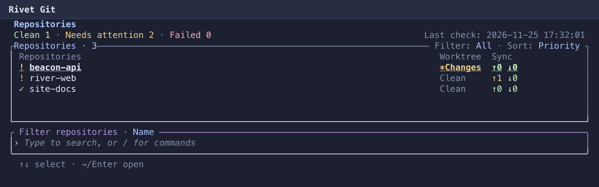
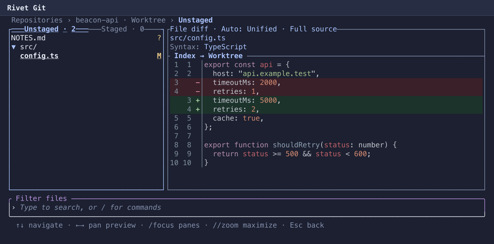
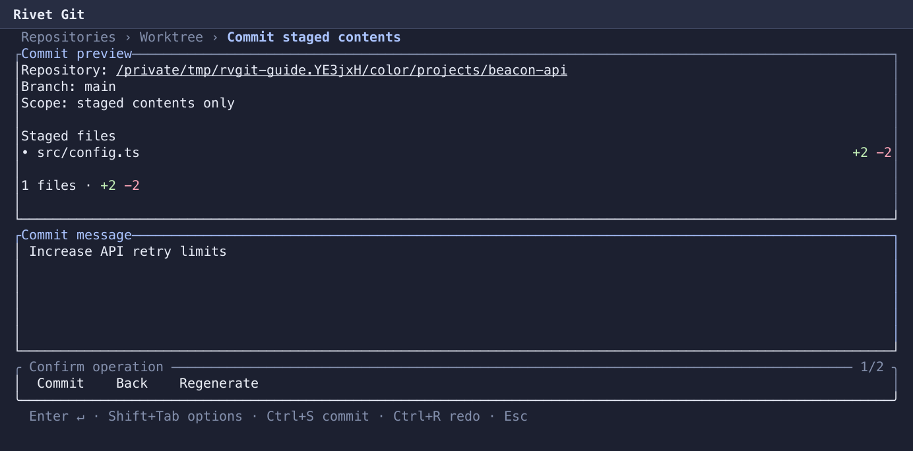
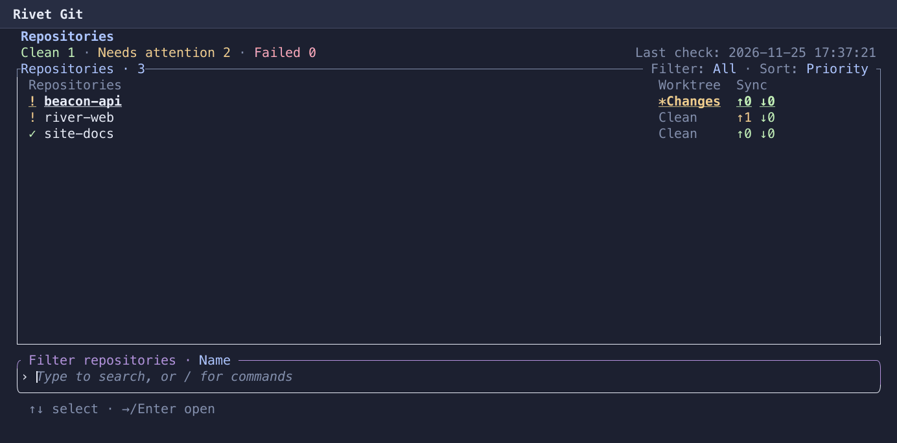

# Rivet Git

[English](README.md) · 简体中文

Rivet Git（`rvgit`）在一个终端里为多个 Git 仓库提供总览。先找到有改动或待同步的项目，再进入仓库查看差异、暂存和提交。



## 安装并启动

安装 Git 和 Node.js 20 或更新版本后，运行：

```sh
npm install -g @efct/rvgit
rvgit repos
```

也可以从 [GitHub Releases](https://github.com/ririv/rvgit/releases/latest) 下载预编译程序，支持 macOS（Apple 芯片和 Intel）、Linux x64 和 Windows x64。安装 Git 后解压对应的文件。macOS 或 Linux 下，在解压目录中运行 `./rvgit repos`。Windows PowerShell 中运行 `.\rvgit.exe repos`。

在任意目录运行 `rvgit repos` 都会打开仓库总览。在 Git 仓库目录里运行 `rvgit` 可以直接进入该仓库。

## 完成第一次提交

找一个含有待查看改动的仓库。如果想用临时仓库练习，请在源码目录运行 `python3 examples/playground/create.py`，再从源码目录运行 `rvgit --home work/playground/workspace/home repos`，打开演练仓库总览。更多场景见[演练仓库指南](examples/playground/README.md)。

### 添加仓库

1. 运行 `rvgit repos` 打开总览，首次启动时按提示完成初始化。
2. 在程序内输入 `//repos add "/path/to/project"` 并按 `Enter`。把示例改成你的 Git 仓库路径，核对路径后，选中**添加**并按 `Enter`。
3. 要一次登记多个项目，输入 `//repos scan "/path/to/projects"`。检查扫描结果，在列表里按 `Space` 调整勾选，然后在操作栏选择**添加选中**。用 `Shift+Tab` 在列表和操作栏之间切换。

在总览输入项目名可以搜索，也可以用 `↑` 和 `↓` 选中仓库，按 `Enter` 打开。“有改动”表示本地工作区有内容可查看。同步栏的 `↑` 和 `↓` 分别表示相对上游领先和落后的提交数，基于本地的远程跟踪引用。用 `//repos fetch` 批量刷新已登记仓库的引用。

### 搜索命令

按 `/` 查看当前界面的可用命令。可以输入部分命令名，也可以搜索中英文说明。用 `↑` 和 `↓` 选择结果，`Tab` 补全，`Enter` 打开或执行，`Esc` 关闭命令列表或返回。

用 `//` 开头可以跨界面搜索，或直接输入完整命令。下面的示例都用 `//`，可以从总览或仓库界面直接输入。

### 查看和暂存改动

1. 选中仓库，运行 `//repo diff` 打开工作区。
2. 在**未暂存**列表中用方向键选中文件。预览会显示暂存区到工作区的差异。用 `//repo diff layout` 可以切换统一或并排布局。
3. 在文件列表中选中文件，运行 `//repo diff stage` 暂存。用 `//repo diff staged` 检查将提交的内容，也可以选中已暂存的文件并运行 `//repo diff unstage` 取消暂存。



已暂存的预览对比的是 `HEAD` 与暂存区。暂存后继续修改同一文件，新的改动会显示在**未暂存**里。

只想暂存文件中的一部分时，选中文件后按 `Enter` 聚焦预览，运行 `//repo diff select hunk` 或 `//repo diff select line`。用方向键选中改动，按 `Space` 暂存。在已暂存的预览中按 `Space` 可以取消暂存选中的改动。

### 检查并提交

1. 运行 `//repo commit`。检查预览中的仓库、分支和文件列表，本次提交只包含已暂存的改动。
2. 输入提交说明，按 `Ctrl+S` 提交。也可以用 `Shift+Tab` 切到操作栏，选中**提交**并按 `Enter`。
3. 用 `//repo log` 确认新提交。要将它发到远程时，运行 `//repo push`，检查推送目标以及界面给出的确认信息。



### 动图演示



## 常用命令

在程序内输入以下命令或使用对应按键。

| 命令或按键 | 用途 |
| --- | --- |
| `//repos` | 返回仓库总览。 |
| `//repos filter` | 选择要显示的仓库。 |
| `//repos sort` | 调整总览的排序。 |
| `//repos fetch` | 一次获取所有已登记仓库的远程更新。 |
| `//repo fetch` | 获取当前仓库的远程更新。 |
| `//repo pull` | 将上游改动拉取到当前分支。 |
| `//repo log` | 浏览当前仓库的提交历史。 |
| `//tasks` | 查看后台任务进度和失败原因。 |
| `F1` | 打开内置帮助，查看命令和按键。 |

界面语言跟随系统。需要手动选择时，在启动前将 `APP_LANG` 设为 `en`（英文）或 `zh`（简体中文）。例如，在 Windows PowerShell 中可以先运行 `$env:APP_LANG = "zh"`，再启动 Rivet Git。

## 从源码安装

先安装 Git，并通过 Rustup 安装 Rust 工具链。克隆本项目：

```sh
git clone https://github.com/ririv/rvgit.git
cd rvgit
```

macOS 需要安装 Xcode Command Line Tools。Linux 需要安装 C 编译器、`pkg-config` 和 OpenSSH 客户端。然后运行：

```sh
./install.sh
```

如果 `~/.local/bin` 还未加入 `PATH`，请先加入，再运行 `rvgit repos`。

Windows 需要安装 MSVC C++ Build Tools，并将 Git for Windows 加入 `PATH`。在源码目录中打开 PowerShell，运行：

```powershell
cargo build --locked --release --package app --no-default-features
.\target\release\rvgit.exe repos
```

要将命令安装到本机，运行 `.\target\release\rvgit.exe install`，再把 `%LOCALAPPDATA%\gw\bin` 加入用户的 `PATH`。

## 许可证

[MIT](LICENSE) · [第三方许可](THIRD_PARTY_NOTICES.md)
